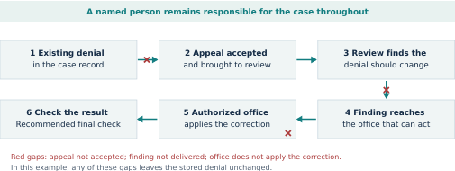

# Can a person get an AI-assisted decision corrected?

Travis Darshan | November 3, 2026

Release 1.1

Release DOI: https://doi.org/10.5281/zenodo.23923506

We studied selected governance commitments in Pope Leo XIV's Magnifica Humanitas (§§97-111). The aim is to show what an institution needs to connect a promised protection to action for the affected person.

## What Lean does

Lean is software that checks logical proofs. We describe imagined cases, state their assumptions and prove claims about them. Lean checks each proof step. In our example, review can be completed while the denial remains unchanged because the finding is never applied.

## The example

Assume an applicant's score is 60 and the cutoff is 50. A 15-point penalty for assisted intake causes a denial. Our agreed standard says intake channel should not affect entitlement. Removing the penalty fixes the calculation. The earlier denial still needs review and an applied correction.

## Three findings to keep in view

- A help desk may not identify the person responsible for the case.
- Human review, access to appeal and power to correct are separate protections.
- An accurate explanation can describe a rule that fails the agreed standard.

## When review finds that the denial should change

A named person remains responsible throughout. Steps 1-5 summarize the checked correction route. Step 6 is the recommended inspection of the returned result. Missing appeal access, finding delivery or applied correction keeps the denial in place in this example.

## Institutional checks

Institutional check | Ask for evidence
--- | ---
Name responsibility | Who is assigned, and what can they change?
Examine the rule | Which rule is used, and does it meet the agreed standard?
Accept a challenge | Did the person's appeal reach a reviewer?
Deliver the finding | Did it reach an office authorized to act?
Apply the correction | Did the new rule or case update take effect?
Check the result | Did the record change? Is payment or other action still due?

## Reading the evidence

The examples are hypothetical. Lean checks consequences of stated rules, not actual agencies or the whole encyclical. The six-page public report explains the source; the technical paper gives proofs, assumptions and the legal comparison.

Full reports and source package: https://doi.org/10.5281/zenodo.23923506

Research, formalization and drafting supported by ChatGPT (OpenAI).
